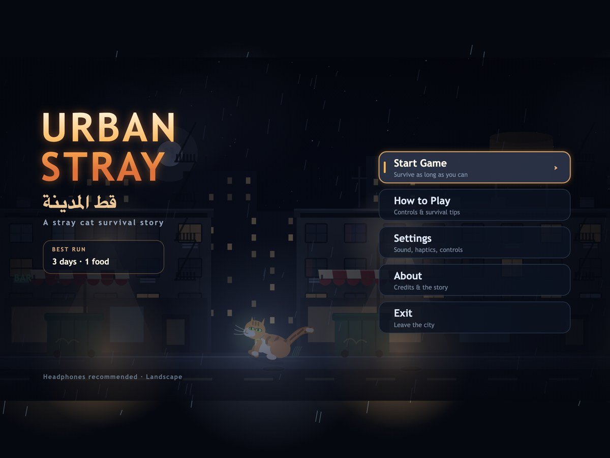
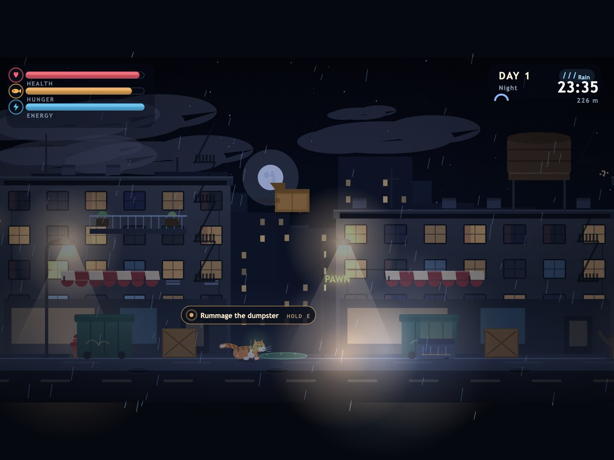
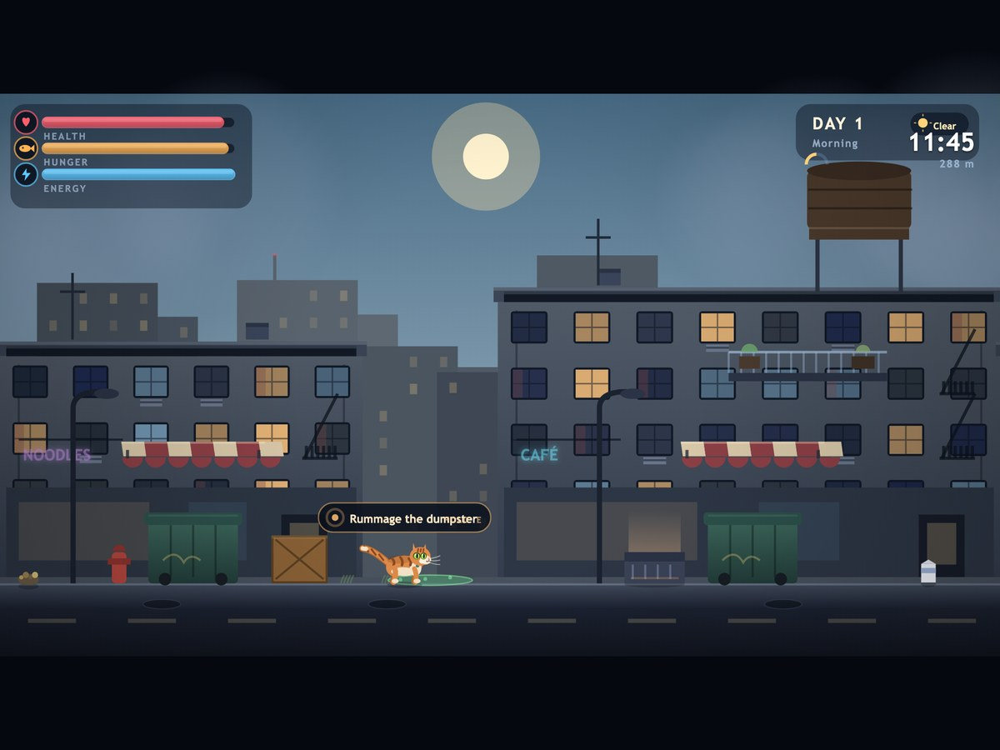
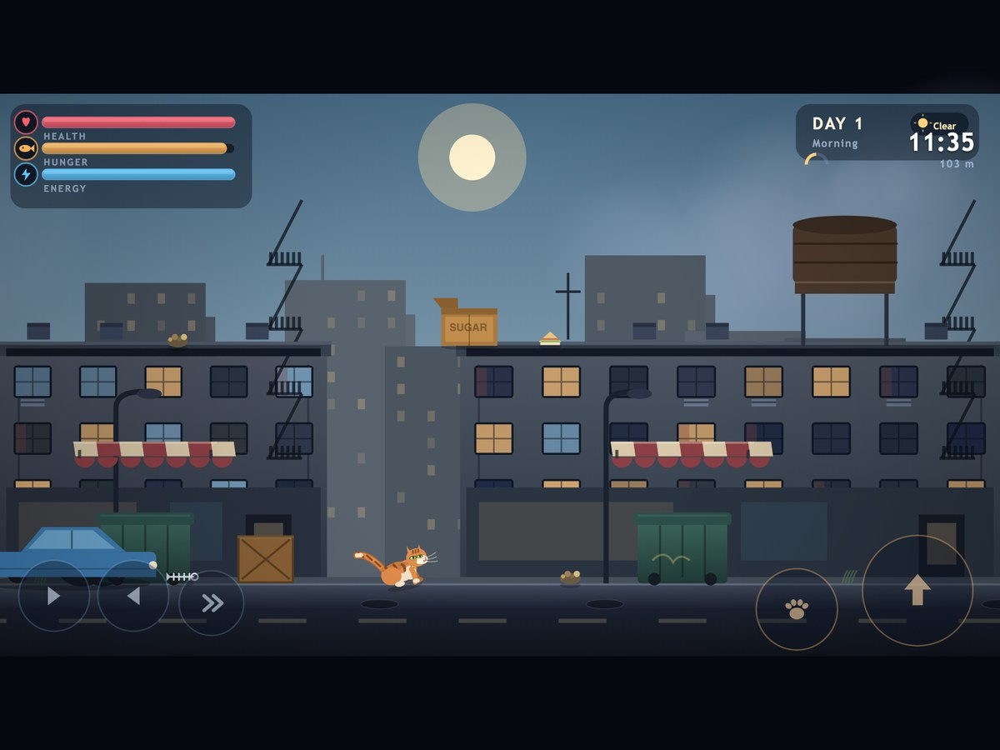

# Urban Stray — قط المدينة

**A 2D side-scrolling survival game about a small ginger stray in a big, indifferent city.**
Scavenge food, dodge traffic, outsmart stray dogs and find somewhere warm to sleep before
your three bars run out.

[](#-download)
[](#-download)
[](#tech-stack)
[](LICENSE)
[](https://github.com/hamouda0024/paws-in-the-city/actions/workflows/android.yml)



---

## ⬇️ Download

### [**Download Urban Stray v1.1.0 (APK, 4.3 MB)**](https://github.com/hamouda0024/paws-in-the-city/raw/main/releases/urban-stray-v1.1.0.apk)

Signed release build · Android 7.0+ (API 24) · landscape · works offline, no ads, no accounts.

**New in 1.1.0**

- Touch menus work: the title, pause, settings and game-over buttons now respond to taps.
- Built-in update check against [`www/version.json`](www/version.json) — an in-game banner
  offers the new build, and the check fails silently when there is no connection.
- Ownership notices on the title and About screens.

**Install on your phone**

1. Download `urban-stray-v1.1.0.apk` on the device (open this repo in the phone browser,
   or transfer the file over USB).
2. Tap the file. Android will ask to allow installs from your browser/file manager —
   allow **"Install unknown apps"** for that app only.
3. Install and launch. Play in landscape; the on-screen pads appear automatically.

**Install over USB instead**

```bash
adb install -r releases/urban-stray-v1.1.0.apk
```

> Every tagged version (`v1.0.1`, `v1.1.0`, …) is built and attached automatically by
> [GitHub Actions](.github/workflows/android.yml) and shows up under
> [**Releases**](https://github.com/hamouda0024/paws-in-the-city/releases). The APK committed in `releases/` is the current signed build.

---

## عن اللعبة (بالعربية)

قطٌّ ضال صغير في مدينة لا تتوقف. اللعبة ثنائية الأبعاد تُلعب بالوضع الأفقي، وتدور حول البقاء
أطول فترة ممكنة: ابحث عن الطعام في الحاويات والأسطح، تجنّب السيارات والكلاب الضالة والمواد
السمّية، واحتمِ في صندوق كرتوني أو فتحة تهوية دافئة لتنام وتستعيد طاقتك.

- ثلاثة أشرطة: **الصحة**، **الجوع**، **الطاقة**.
- أسطح المباني هي الطبقة الآمنة: الكلاب والسيارات لا تصعد إلى هناك.
- دورة ليل ونهار وأمطار متغيّرة تزيد صعوبة المدينة.
- تحكّم كامل باللمس، يعمل بدون إنترنت.

**للتحميل:** من الرابط أعلاه، ثم افتح ملف الـ APK على الهاتف واسمح بتثبيت التطبيقات من
مصادر غير معروفة عند الطلب.

---

## Screenshots

| Night on the street | Daylight rooftops |
| --- | --- |
|  |  |

| Touch controls | Title screen |
| --- | --- |
|  |  |

---

## Gameplay

**Three bars, one life.**

- **Hunger** drains constantly — faster while sprinting, in rain, and at night. At zero,
  health starts draining. Eating heals a little too.
- **Health** drops from cars, dogs, toxic runoff and bad falls; it regenerates slowly while
  well fed.
- **Energy** is spent sprinting, jumping and clawing walls; sleeping restores it fast.

**The city** streams in 960 px chunks: two buildings per chunk, each with a climbable chain of
dumpster → awning → balcony → rooftop, plus alleys, toxic runoff, loot, sleeping spots and
locals. One full day lasts 2m48s of play.

**Hazards and life**

- **Cars** enter with a horn, a headlight beam and an edge arrow, then sweep the street —
  faster at night and in the rain.
- **Stray dogs** patrol, chase, bark and bite. They can be distracted by food left on the
  ground, which is a genuinely useful escape route.
- **Kind humans** drop a sandwich when the cat comes close; some carry umbrellas in the rain.
- **Mice** bolt when you get near and are free nutrition if you catch one.
- **Dumpsters** can be rummaged for scraps, milk, nothing — or a rat. The noise may attract a dog.
- **Boxes and warm vents** are sleeping spots. Time accelerates while you sleep, so naps cost daylight.
- **Weather**: rain cycles add spray, wet reflections, fog and a louder soundscape; night
  darkens the city, speeds up traffic, drains hunger faster and makes food glow faintly.

**Movement feel**: coyote time and jump buffering (forgiving on touch), variable jump height,
a pounce burst out of a sprint, wall-claw slides instead of wall jumps, landing squash scaled
by impact, a spring-driven tail, ear flicks, slow blinks, idle sitting and purring.

---

## Controls

| Action | Keyboard | Touch |
| --- | --- | --- |
| Move | `←` `→` / `A` `D` | left pad (arrow buttons) |
| Sprint | `Shift` / `K` | chevron pad |
| Jump (hold for height) | `Space` / `W` / `↑` | large arrow pad |
| Rummage / sleep / meow | hold `E` / `F` / `J` | paw pad |
| Pause | `Esc` / `P` | pause via the system UI |

Menus work with arrows + `Enter`, or by tapping. Settings (sound, haptics, touch controls) and
the best-run record persist in `localStorage`.

---

## Tech stack

A **custom Canvas 2D engine with zero runtime dependencies**, wrapped in **Capacitor 8** for
Android. No engine runtime, no sprite sheets, no audio files: all art is drawn with vector paths
and all sound is synthesized with WebAudio at runtime, which keeps the APK at ~4 MB with
instant load and 60 FPS physics.

| Layer | Choice |
| --- | --- |
| Rendering | Canvas 2D, fixed 960×540 virtual view, letterboxed, DPR capped at 2 |
| Audio | Procedural WebAudio (rain, sirens, meows, dogs, cars, UI) |
| Packaging | Capacitor 8 → Gradle → signed APK |
| Target | Android 7.0+ (minSdk 24, target 36), landscape, immersive fullscreen |
| Dependencies | Capacitor CLI/platform only — the game itself needs nothing at runtime |

## Project layout

```
www/
  index.html            canvas shell, letterbox + rotate hint
  styles.css            full-bleed, gesture-proof page
  icon-512.png          generated app icon
  version.json          release manifest read by the in-game update check
  js/
    main.js             boot, DPR/letterbox transform, frame loop, lifecycle
    config.js           ALL tuning: physics, survival rates, hazards, palette, build version
    core/
      input.js          keyboard + touch actions, UI button hit-testing
      updates.js        silent version check + "open download" helper
      audio.js          procedural WebAudio engine
      draw.js           canvas helpers (rounded rects, text, glows)
      rng.js            seeded RNG, math, colour utils
    game/
      game.js           state machine, camera, damage rules, records, render pipeline
      world.js          chunk streaming, terrain/rooftops, weather, traffic
      cat.js            player physics, procedural animation, vector drawing
      entities.js       cars, dogs, humans, mice, food, sleep spots
      background.js     sky palettes, parallax skyline, facades, street, lighting
      hud.js            bars, clock, prompts, toasts, touch pads
      screens.js        title / how-to / settings / about / pause / game over
      particles.js      pooled effects (dust, splash, crumbs, Zzz, hearts)
      survival.js       stats + time-of-day logic
tools/
  setup-android-toolchain.sh   rootless JDK 21 + Android SDK 36 installer
  serve.mjs                    dependency-free static dev server
  make-icons.py                generates launcher icons + splash from code
scripts/
  build-apk.sh                 sync + sign + assemble + verify
android/                       Capacitor Android shell (Gradle project)
releases/                      signed APK builds for direct download
docs/screenshots/              README images
```

### Render order

1. sky gradient, stars, sun/moon, clouds
2. two parallax skylines
3. building facades (windows light up at night), storefront glow, signage, fire escapes
4. street, lamps, props, puddles
5. cars → entities → cat → particles (world space)
6. rain, fog, night grading + light pools, vignette
7. HUD / menus

### Tuning

Everything lives in [`www/js/config.js`](www/js/config.js): movement speeds, gravity, jump
velocity, hunger/energy rates, hazard damage, day length, weather windows and the palette.
Survival rates are separate from physics so balance passes never touch the controller.

---

## Develop

```bash
npm ci          # Capacitor CLI + Android platform (the web game itself has no dependencies)
npm run dev     # http://localhost:3000
```

Enable **Settings → Touch controls → Always** to preview the mobile pads on desktop.

## Build the Android APK

One-time toolchain (no root, installs into `~/toolchain`):

```bash
./tools/setup-android-toolchain.sh
```

Then:

```bash
./scripts/build-apk.sh          # signed release -> dist/urban-stray-release.apk
./scripts/build-apk.sh debug    # debug build   -> dist/urban-stray-debug.apk
```

The script installs JS tooling if missing, runs `npx cap sync android`, generates a local
upload keystore on first use (git-ignored), assembles with Gradle, copies the APK to `dist/`
and prints package metadata plus a signature check.

Manual equivalent:

```bash
export JAVA_HOME="$HOME/toolchain/jdk" ANDROID_HOME="$HOME/toolchain/android"
npx cap sync android
cd android && ./gradlew assembleRelease
```

### Android shell configuration

| Setting | Value |
| --- | --- |
| Application ID | `com.urbanstray.cat` |
| Orientation | `sensorLandscape` (locked landscape, both rotations) |
| Screen | Immersive sticky — system bars hidden (`MainActivity.java`) |
| Keep-awake | `FLAG_KEEP_SCREEN_ON` |
| SDK | min 24, target/compile 36 |
| Permissions | `VIBRATE` (haptics); `INTERNET` is Capacitor's default |

### Continuous integration

`.github/workflows/android.yml` builds on every push and pull request, uploads the APK as a
build artifact, and — when a `v*` tag is pushed — publishes a GitHub Release with the APK
attached. Add `ANDROID_KEYSTORE_BASE64`, `ANDROID_KEYSTORE_PASSWORD`, `ANDROID_KEY_ALIAS` and
`ANDROID_KEY_PASSWORD` as repository secrets for signed CI builds (otherwise CI produces a
debug-signed APK).

```bash
git tag v1.1.1 && git push origin v1.1.1
```

### Publishing an update (in-app update check)

The game reads [`www/version.json`](www/version.json) about 1.5 s after boot, compares it
with `APP_VERSION` in `www/js/config.js` and, only if the manifest is newer, shows a
non-blocking card on the title screen with a **Download update** button. Publish a release by:

1. Bumping `APP_VERSION` (`www/js/config.js`), `version` (`package.json`),
   `versionCode`/`versionName` (`android/app/build.gradle`) and `www/version.json` —
   `version` plus the `downloadUrl` of the new APK.
2. Building and committing the APK to `releases/`, then pushing to `main`.

Offline, DNS, CORS, timeout and malformed-JSON failures are caught and the check simply
stays quiet — it can never block or crash the game. Point it at another manifest for
testing with `window.__urbanStrayUpdateUrl = '/version.json'`. On Android the download
button opens the system browser through `@capacitor/browser`.

---

## Performance notes

- Fixed 960×540 virtual view, DPR capped at 2, `alpha: false` + `desynchronized` canvas.
- Gradients cached and reused; particles capped at 320; entities culled outside the camera.
- Chunks are dropped behind the camera; physics substeps only when a frame would move the cat
  more than ~18 px.

## Known limitations

- Built on Chromium/WebView rendering, not a native renderer; the night lighting pass is the
  most expensive part on very old low-end devices.
- Endless procedural difficulty ramp — no authored levels or cloud saves.
- Audio requires one tap to unlock, per WebView autoplay rules.
- Verified in Chromium (same engine as Android WebView) and via APK metadata/signature checks;
  physical-device playtesting is still pending.

## Contributing

See [CONTRIBUTING.md](CONTRIBUTING.md) and [CHANGELOG.md](CHANGELOG.md).
Bug reports are welcome through the issue template.

## Ownership & license

Urban Stray © 2026 **Zerguine Ahmed Islam** — حقوق الملكية محفوظة لـ زرقين أحمد إسلام.
The ownership notice is shown in-game on the title screen and the About screen.

The source code is released under the [MIT license](LICENSE); the MIT terms cover the code,
while the copyright notice above identifies the author and owner of the game.

## Credits

Design, code, art and audio: procedural, generated at runtime by this project.
Packaging: [Capacitor](https://capacitorjs.com). Dedicated to every cat that ever owned a street.
